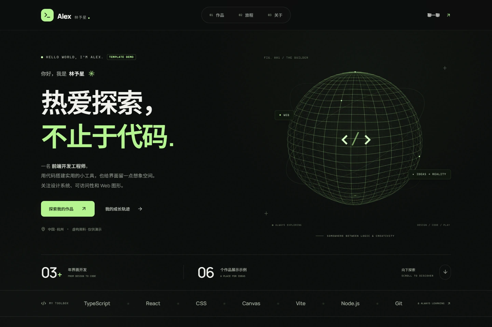
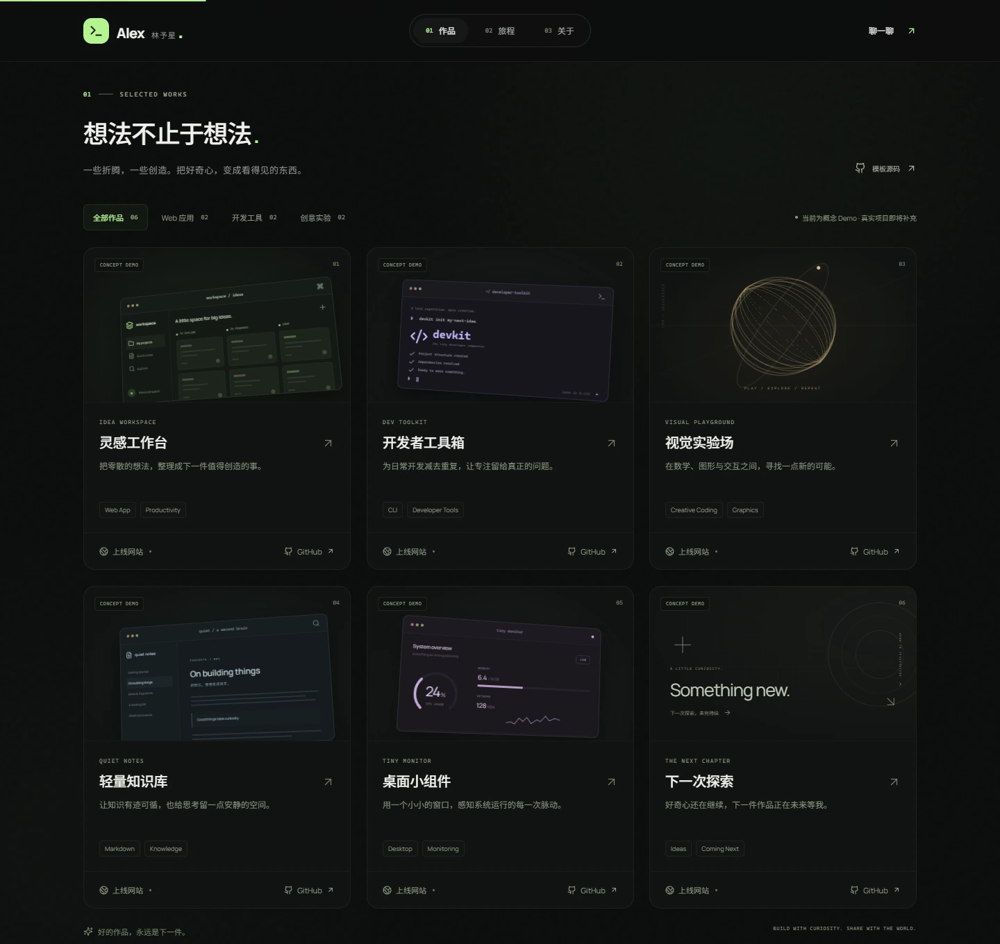
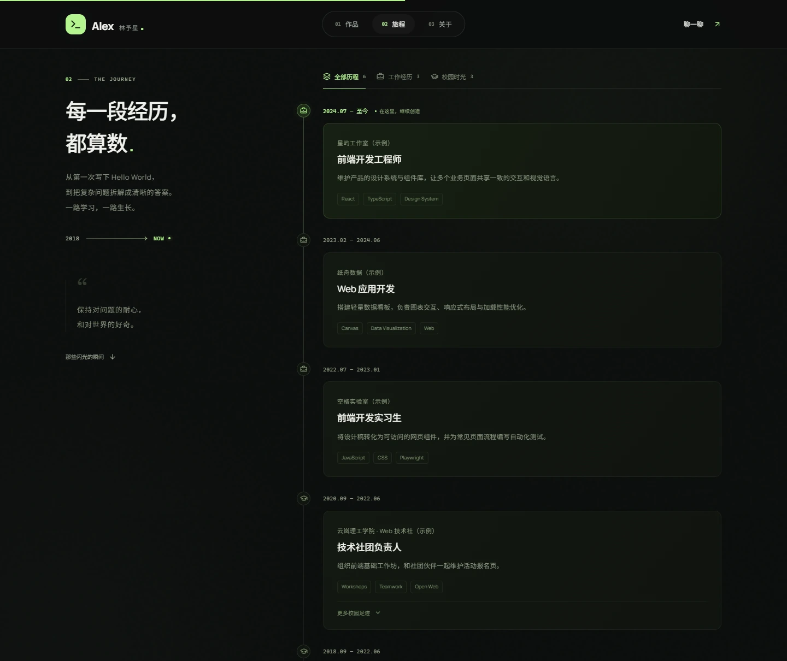
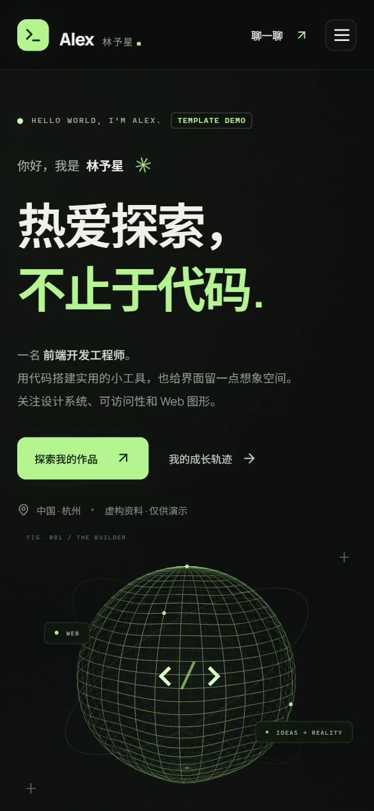

# PersonalSiteTemplate

一个黑色主题的开源个人网站模板，内置 3D 鼠标交互、作品矩阵和成长时间线，替换示例数据即可发布自己的站点。

[在线演示](https://mannixyang.github.io/PersonalSiteTemplate/) · [使用此模板](https://github.com/MannixYang/PersonalSiteTemplate/generate) · [MIT License](LICENSE)



> 演示中的人物、工作与校园经历、荣誉和项目均为虚构示例；`example.com` 邮箱不用于收信。仓库不包含原个人网站的简历、履历或联系方式。

## 截图

| 作品矩阵                                                                                                  | 成长时间线                                                                                              | 移动端                                                                                        |
| --------------------------------------------------------------------------------------------------------- | ------------------------------------------------------------------------------------------------------- | --------------------------------------------------------------------------------------------- |
| [](docs/screenshots/desktop-projects.webp) | [](docs/screenshots/desktop-timeline.webp) | [](docs/screenshots/mobile-home.webp) |

## 特点

- **作品展示**：分类筛选、项目详情、上线网站和 GitHub 仓库入口。可沿用六种代码绘制的封面，也可换成自己的截图。
- **个人时间线**：工作 / 校园筛选、校园详情折叠、荣誉列表；个人简介、技术栈和联系方式集中维护。
- **动态细节**：Canvas 线框球体、鼠标跟随光晕、3D 卡片倾斜和滚动渐入；触屏保留点击操作，支持系统的“减少动态效果”设置。
- **轻量部署**：React、TypeScript、Vite 与原生 CSS / Canvas，无需后端、数据库、API 密钥或远程字体服务。

## 快速开始

需要 **Node.js 22.12+**（推荐 Node.js 24）。点击仓库的 **Use this template** 创建自己的仓库，或克隆本仓库试用：

```bash
git clone https://github.com/MannixYang/PersonalSiteTemplate.git
cd PersonalSiteTemplate
npm ci
npm run dev
```

在浏览器中打开终端给出的地址（默认 `http://127.0.0.1:5173/`）。如端口被占用，可运行 `npm run dev -- --port 5174`。

### 改成自己的站点

编辑 [`src/data.ts`](src/data.ts)，不必先改页面组件：

| 配置       | 用途                                                                                            |
| ---------- | ----------------------------------------------------------------------------------------------- |
| `profile`  | 名称、岗位、文案、技术栈、GitHub、邮箱、兴趣及站点 SEO 文案。正式发布前将 `demo` 改为 `false`。 |
| `projects` | 项目简介、分类、标签、封面、上线网站和 GitHub。正式项目设 `demo: false`，未知链接保留 `null`。  |
| `journey`  | 校园与工作经历，按希望展示的顺序排列；`type` 决定筛选分类。                                     |
| `awards`   | 竞赛与荣誉列表，前四项作为精选卡片。                                                            |

例如，给项目填写 `cover: 'images/my-project.webp'`，并把图片放到 `public/images/my-project.webp`。项目分类取值为 `web`、`tools` 或 `experiments`；没有截图时通过 `visual` 选择自带封面。若不填写 `profile.github`，默认显示“模板源码”链接。

配色和布局在 [`src/styles.css`](src/styles.css)，站点图标在 [`public/favicon.svg`](public/favicon.svg)。中文字体为自托管子集，新增字符可回退至系统字体；需要刷新子集时运行 `npm run fonts:refresh`（此命令需要联网，正常浏览和构建不需要访问字体服务）。

### 构建与部署

```bash
npm run build
npm run preview
```

把生成的 `dist/` 部署到静态托管服务即可，已支持仓库子路径部署。用 **GitHub Pages** 时，在自己的仓库中选择 **Settings → Pages → Source → GitHub Actions**，然后在 **Actions → Deploy GitHub Pages** 中点 **Run workflow**。每次需要发布新版本时再次运行工作流。个人正式站点上线前，请确认内容与链接均可公开。

### 测试

```bash
npx playwright install chromium
npm run test:e2e
```

默认 Demo 的浏览器验收覆盖项目和经历筛选、弹窗与键盘操作、邮箱复制、触屏、减少动态效果、11 档窗口宽度及桌面 / 移动端无障碍自动扫描。脚本优先使用已安装的 Edge 或 Chrome，找不到时回退到 Playwright Chromium。替换示例数据后，可同步调整 [`scripts/smoke-test.mjs`](scripts/smoke-test.mjs) 中的示例断言。

## 许可

源码与本仓库自制的界面截图采用 [MIT](LICENSE) 许可。Manrope 和 Noto Sans SC 字体使用 SIL Open Font License，各自的许可见 [`public/fonts/`](public/fonts/)。第三方依赖遵循其各自的许可。
